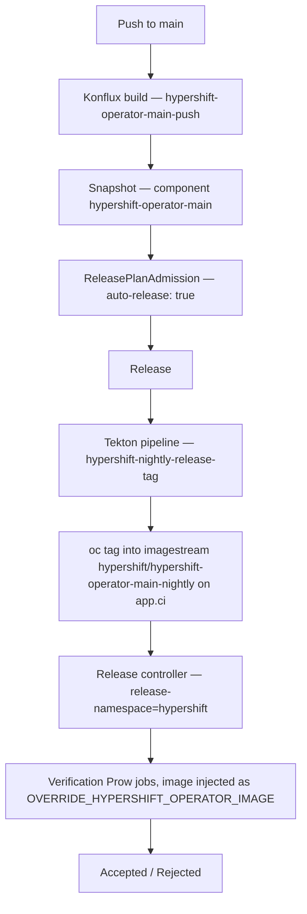

# HyperShift Operator Nightly Releases

The HyperShift Operator built from `main` is published as a **nightly release
stream**, gated by the same OpenShift release controller that accepts and
rejects OCP nightly payloads. Each nightly is an operator image that has been
tagged, tested against a matrix of e2e jobs, and marked `Accepted` or
`Rejected`.

Browse the stream at
**[hypershift-release.apps.ci.l2s4.p1.openshiftapps.com](https://hypershift-release.apps.ci.l2s4.p1.openshiftapps.com)**.

What this buys the team:

- A pull spec you can point at that is known to have passed e2e, rather than
  "whatever `main` built last".
- A changelog between any two nightlies, rendered from the commits that went
  into them.
- A single place to see which e2e jobs are failing on `main` over time.

!!! important "This is a `Layered` release stream, not a release payload"

    Everything below follows from this. The nightly tag **is** the HyperShift
    Operator image. There is no `oc adm release new`, no payload, no CVO and no
    `RELEASE_IMAGE_LATEST`. Verification jobs install OpenShift the normal way
    and override a single image. If you come to this from OCP payload
    experience, that is the assumption to drop.

!!! note "Status — remove this note once the work has landed"

    This page describes the intended end state. At the time of writing, two
    pieces are still in flight: dating tags by the commit (with rebuild
    counters), and the `creationTimestamp` in the baked
    `image-references`. Until those merge, nightly tags are dated by the time
    the release ran and the changelog `Created` header renders as
    `0001-01-01`. Everything else is live.

## How it works



### 1. Konflux builds the operator

A push to `main` triggers `.tekton/hypershift-operator-main-push.yaml`, which
runs the shared `common-operator-build` pipeline and pushes
`quay.io/redhat-user-workloads/crt-redhat-acm-tenant/hypershift-operator/hypershift-operator-main:<revision>`.

The build bakes `/release-manifests/image-references` into the image — see
[Changelogs](#changelogs-and-the-release-manifests-contract).

### 2. Konflux creates a Snapshot and a Release

Konflux's Integration Service creates a **Snapshot** describing the built
components. The **ReleasePlanAdmission** (RPA) in the
`crt-redhat-acm-tenant` namespace has `auto-release: "true"`, so a **Release**
is created automatically for every matching Snapshot.

The RPA is also where per-component tagging config lives:

```yaml
spec:
  data:
    mapping:
      components:
      - name: hypershift-operator-main                     # must match the Snapshot component
        destination-imagestream: hypershift/hypershift-operator-main-nightly
        release-version: "0.0.1"                           # optional, see below
```

!!! warning "Component names must match exactly"

    The `apply-mapping` task deep-merges `mapping.components[]` into the
    Snapshot components **by name**. A mapping entry whose name is not in the
    Snapshot — or a Snapshot component not in the mapping — is silently
    dropped, not reported as an error. If a release runs and tags nothing, a
    name mismatch is the first thing to check.

### 3. The tag pipeline runs

The Release runs `.tekton/pipelines/nightly-release-tag.yaml`
(`hypershift-nightly-release-tag`), which:

1. `verify-access-to-resources` — checks the pipeline can read the release CRs.
2. `collect-data` — merges `spec.data` from the Release, ReleasePlan and RPA
   into `data.json`.
3. `apply-mapping` — merges the mapping into the Snapshot components.
4. `tag-image` — computes a tag per component and runs `oc tag` against the CI
   cluster.

`tag-image` authenticates to app.ci with a kubeconfig from the
`hypershift-ci-cluster-credentials` secret, mounted at `/credentials/kubeconfig`.

!!! note "Why the pipeline uses `catalogGitUrl` and not `taskGitUrl`"

    The pipeline lives in `openshift/hypershift` but resolves its tasks from
    the [release-service-catalog](https://github.com/konflux-ci/release-service-catalog).
    release-service automatically injects `taskGitUrl` pointing at whichever
    repo the *pipeline* was resolved from — which would redirect catalog task
    lookups into `openshift/hypershift`, where they do not exist. The dedicated
    `catalogGitUrl` / `catalogGitRevision` params exist to avoid that. Pin
    `catalogGitRevision` to a commit rather than tracking the moving
    `production` branch when you want a reproducible run.

### 4. The release controller picks up the tag

A dedicated release controller instance runs on app.ci with
`--release-namespace=hypershift`, watching the
`hypershift-operator-main-nightly` imagestream. Its configuration is annotated
onto that imagestream from `openshift/release` — see
[Configuration](#configuration).

When a new tag appears the controller creates a release, launches the
verification Prow jobs, and moves the release to `Accepted` or `Rejected`.

## How a nightly gets its name

A nightly tag is a version plus a semver pre-release segment:

```
0.1.86-0148-g0bb9d28005.nightly-2026-10-02-174500
└────────── version ───────────┘└────── nightly segment ──────┘
```

### The version

Either the RPA's `release-version` for that component, or — when it is omitted
— derived by running `git describe --tags` against the component's
`source.git.revision`.

!!! tip

    `source.git.revision` is **the commit the image was built from**, not the
    branch head. `main` moves on after a build; the tag has to describe the
    artifact being tagged. A leading `v` is stripped, because this repository's
    tags are `v`-prefixed but imagestream tags are built from a bare version.

    The RPA currently pins `release-version: "0.0.1"`. Remove that field from
    the mapping entry to get `git describe`-derived versions instead.

A component with neither a mapped `release-version` nor a describable revision
is a hard error — the release fails rather than publishing a misnamed tag.

### Why the commit count is zero padded

`git describe` reports the commit distance unpadded — `0.1.86-148-g0bb9d28005`.
In semver terms `148-g0bb9d28005` is a **single pre-release identifier**, and
because it carries the hash it is alphanumeric, so semver compares it
*lexically* rather than numerically. Unpadded, `100-g…` sorts below `98-g…` and
the stream lists out of order.

The pipeline pads the count to `COUNT_WIDTH` (4) digits, which makes the
lexical order the numeric one:

```
0.1.86-0007-g0bb9d28005.nightly-…
0.1.86-0098-g0bb9d28005.nightly-…
0.1.86-0148-g0bb9d28005.nightly-…
0.1.86-1024-g0bb9d28005.nightly-…
```

!!! note "Why pad rather than use a dot"

    Giving the count its own identifier — `0.1.86-148.g0bb9d28005` — would make
    it numeric, sort correctly, and need no width at all. It is not used
    because the release controller parses prowjob names with
    `^(?P<prerelease>[a-z0-9-]+)\.(?P<stream>…)`, which expects
    `<count>-g<sha>` to be one identifier and the dot to introduce the stream.
    Splitting on a dot makes that expression fail to match, so the fix would
    have to span both repos.

A count that outgrows `COUNT_WIDTH` sorts below every padded one. The pipeline
logs a warning rather than failing, since a bad sort order is less harmful than
a blocked release — if you see it, widen `COUNT_WIDTH`. Consecutive tags in this
repository are a few hundred commits apart, so 4 digits has roughly 60× headroom.

!!! warning "Expect a transient ordering glitch after this change ships"

    Nightlies published before padding keep their unpadded names, and an
    unpadded `98-g…` sorts *above* a padded `0148-g…`. The two formats coexist
    until the old tags age out at `expires: 672h` (28 days).

### Where the nightly segment attaches

This looks fussy but is load-bearing; please do not "simplify" it.

| Version | Tag | Why |
|---|---|---|
| `0.0.1` | `0.0.1-0.nightly-<ts>` | A plain release has no pre-release segment, so `-0` opens one. |
| `0.1.86-0148-g0bb9d28005` | `0.1.86-0148-g0bb9d28005.nightly-<ts>` | `git describe` already appended a pre-release segment (commit distance and hash), so the nightly extends it with a `.`. A second `-0` would not open a new segment, it would just add a confusing `0` to the existing one. |

### The timestamp

`<ts>` is the **committer date of the commit the image was built from**, not
the time the release ran. That makes the tag name agree with the `Created`
header of the changelog, which `oc adm release info` renders from the image's
own `release-manifests/image-references`. If the commit date cannot be read the
pipeline falls back to the release run time and logs a warning.

### Rebuild counters

Because the tag is a function of the commit, a rebuild of an already-released
revision — which Konflux does whenever its base images move — recomputes a tag
that is already taken. Those rebuilds are worth shipping, so `tag-image`
appends a counter rather than repointing a published tag at a different image:

```
0.0.1-0.nightly-2026-10-02-174500
0.0.1-0.nightly-2026-10-02-174500-1
0.0.1-0.nightly-2026-10-02-174500-2
```

Re-releasing an image that is *already* tagged is a no-op, so a retried Release
cannot publish one image twice under two names. The counter stops at 50 as a
guard against runaway tagging.

!!! note "Known limitation"

    The counter lands inside an alphanumeric semver pre-release identifier,
    which is compared lexically. A tenth rebuild of a single commit would sort
    between `-1` and `-2`. Switching the separator from `-` to `.` would make
    it a numeric identifier and order correctly without a bound.

## Changelogs and the `release-manifests` contract

`oc adm release info --changelog` is payload-only: it extracts
`release-manifests/image-references` from the image's **topmost layer** and
errors out when the file is absent. The HyperShift Operator image is not a
payload, so the build fakes a minimal one-tag ImageStream to satisfy it.

`release-manifests/image-references.template.yaml` is rendered by
`Containerfile.operator` from three build args, wired up in
`.tekton/pipelines/common-operator-build.yaml`:

| Build arg | Source | Used for |
|---|---|---|
| `COMMIT_HASH` | `clone-repository` task's `commit` result | `io.openshift.build.commit.id` — the endpoint of the commit range `oc` diffs |
| `RELEASE_IMAGE_REFERENCE` | the pipeline's `output-image` param | the tag's `from.name` |
| `SOURCE_DATE_EPOCH` | `clone-repository` task's commit-timestamp result | `metadata.creationTimestamp`, the `Created` header |

`oc` generates the changelog entirely from the `io.openshift.build.*`
annotations: it clones `source-location` and runs `git log` over the range
between the two builds' `commit.id` values. A single tag naming this repository
is therefore enough.

!!! danger "Three ways to silently break changelogs"

    - **Unquoting the template values.** A sha that happens to look numeric is
      coerced by the YAML parser and the tag silently drops out of the diff.
    - **Removing `from.name`.** A tag without a `DockerImage` reference is
      dropped from the diff entirely. It is only *read* when both builds report
      the same commit, but it has to be set.
    - **Removing `changelogGeneration: FromImageReferences`** from the release
      controller config. `Layered` streams default to `Disabled`.

    Each of these produces an empty or missing changelog rather than an error.

Build args are taken from the clone task result rather than read inside the
build because on PR builds the clone task merges the target branch, leaving
`HEAD` a merge commit dated at clone time.

## Configuration

Configuration is spread across four places. Find the row for what you want to
change:

| I want to change… | Where | Who approves |
|---|---|---|
| Which e2e jobs gate a nightly, blocking vs informing, retries, expiry, release cadence | `openshift/release` → `core-services/release-controller/_releases/hypershift/release-hcp-main.json` | **HyperShift team** (self-serve) |
| Who can approve the above | the `OWNERS` file alongside it | HyperShift team |
| Tag computation, destination imagestream, catalog pin | this repo → `.tekton/pipelines/nightly-release-tag.yaml` | HyperShift team |
| Changelog metadata baked into the image | this repo → `Containerfile.operator`, `release-manifests/image-references.template.yaml`, `.tekton/pipelines/common-operator-build.yaml` | HyperShift team |
| Component mapping, auto-release on/off, Enterprise Contract policy | the `ReleasePlanAdmission` in the `crt-redhat-acm-tenant` Konflux namespace | see [Konflux resources](#konflux-resources) |
| CI cluster credentials, trusted-artifacts push secret | secrets in `crt-redhat-acm-tenant` | see [Konflux resources](#konflux-resources) |

### Release controller config

`release-hcp-main.json` is annotated onto the imagestream by
`hack/annotate.sh` in `openshift/release`:

```bash
annotate "hypershift" "hypershift-operator-main-nightly" "hcp-main.json" "hypershift"
```

The fourth argument is the subdirectory under `_releases/`. It was previously a
boolean meaning "private"; it was generalised so HyperShift could own a
directory with its own `OWNERS` file, which is what makes this config
self-serve rather than requiring a DPTP approval.

The fields worth knowing:

| Field | Current value | Effect |
|---|---|---|
| `as` | `Layered` | The tag is the image, not a payload. Disables payload-only behaviour such as node image info. |
| `layeredImageEnvVar` | `OVERRIDE_HYPERSHIFT_OPERATOR_IMAGE` | The env var the image is injected into for verify jobs. Can be overridden per-job. |
| `changelogGeneration` | `FromImageReferences` | Must be set explicitly; `Layered` defaults to `Disabled`. |
| `maxUnreadyReleases` | `1` | No new release while one is still being verified. |
| `minCreationIntervalSeconds` | `14400` | At most one release per 4 hours (≈6/day). |
| `expires` | `672h` | Tags are pruned after 28 days. |
| `mirrorPrefix` | `hypershift-latest` | Prefix for the mirror imagestream. |
| `referenceMode` | `source` | Keep the originating pull spec rather than copying images. |
| `verify` | a map of job names | The gate. See below. |

A `verify` entry looks like:

```json
"release-5.1-e2e-aks": {
    "maxRetries": 2,
    "prowJob": {
        "name": "periodic-ci-openshift-hypershift-release-5.1-periodics-e2e-aks"
    }
}
```

Add `"optional": true` to make a job informing — it runs and is reported, but
does not block acceptance. **New jobs should always start optional** and be
promoted to blocking once they have proven stable against the stream.

The current gate is structured by OCP version: `release-5.1` jobs are blocking
with retries, and `release-5.0` and `4.20`–`4.23` jobs run as informing
back-compatibility signal.

### How verification jobs consume the image

The controller injects the nightly's pull spec into
`OVERRIDE_HYPERSHIFT_OPERATOR_IMAGE`, which is read by the
`hypershift/install` step-registry ref in `openshift/release`. The step uses it
for both the operator image **and** the `hcp` CLI, extracted from the same
image, bypassing the usual pipeline ImageStream dependency resolution.

!!! important "Any job you add to the gate must install via `hypershift/install`"

    If a job builds its own operator image instead, it will run happily and
    report green — while testing something other than the nightly under test.
    Check the job's workflow before adding it to `verify`.

Override precedence inside the step, highest first:

1. `OVERRIDE_HYPERSHIFT_OPERATOR_IMAGE`
2. `HO_MULTI`
3. `INSTALL_FROM_LATEST`

Setting more than one logs a warning.

!!! note "The `MULTISTAGE_PARAM_OVERRIDE_` prefix"

    Jobs triggered through Gangway cannot set step parameters directly, so the
    image travels in `MULTISTAGE_PARAM_OVERRIDE_OVERRIDE_HYPERSHIFT_OPERATOR_IMAGE`
    and the install script copies it across at runtime. That double `OVERRIDE`
    is not a typo.

### Konflux resources

The ReleasePlanAdmission and the secrets it depends on
(`hypershift-ci-cluster-credentials`, the trusted-artifacts push credential)
live in the `crt-redhat-acm-tenant` namespace.

!!! danger "These are not currently in version control"

    They are applied manually. Before editing them, find out the current source
    of truth — ask in the team channel rather than assuming the live cluster
    state is intentional, and capture any change you make somewhere durable.

The RPA also references:

- `policy: hypershift-nightly` — the Enterprise Contract policy enforced before
  release.
- `serviceAccountName: release-service-account` — needs RBAC to GET
  `release`/`releaseplan`/`releaseplanadmission`/`snapshot`, and a linked quay
  push secret for the trusted-artifacts steps.

## Runbooks

### Add a new e2e job to the gate

1. Confirm the job installs HyperShift via the `hypershift/install`
   step-registry ref.
2. Open a PR against `openshift/release` adding an entry to the `verify` map in
   `_releases/hypershift/release-hcp-main.json`, with `"optional": true`.
3. Merge it — the HyperShift `OWNERS` file means the team can approve this.
4. Watch a few nightlies. Once the job is reliably passing, drop `optional` and
   add `"maxRetries": 2` to make it blocking.

### A nightly was rejected

1. Open the release in the
   [controller UI](https://hypershift-release.apps.ci.l2s4.p1.openshiftapps.com)
   and find the failing job.
2. Follow through to the Prow job and its artifacts.
3. Confirm the job actually tested the nightly: the install step logs
   `WARNING: Overriding OPERATOR_IMAGE` with the override pull spec. If it does
   not, the job is not wired to the override and the result is not about this
   nightly.
4. Use the changelog between the last accepted nightly and this one to narrow
   down the commit range.

### No new nightlies have appeared

Work down the chain:

1. **Konflux build** — did the push to `main` build successfully?
2. **Snapshot** — `oc get snapshots -n crt-redhat-acm-tenant`.
3. **Release** — `oc get releases -n crt-redhat-acm-tenant`. If no Release was
   created, check `auto-release` on the RPA and that the RPA's `applications`
   and `origin` match.
4. **Release pipeline** — check the PipelineRun. Common failures: a component
   name mismatch dropping everything in `apply-mapping` (the pipeline errors
   with "mapped snapshot contains 0 components"), an expired CI kubeconfig, or
   `oc tag` RBAC on app.ci.
5. **Cadence** — `minCreationIntervalSeconds: 14400` and
   `maxUnreadyReleases: 1` both legitimately suppress new releases. A nightly
   stuck in verification blocks the next one.

For archived Konflux PipelineRuns and logs, see
[Konflux CI Scripts](konflux-scripts.md).

### Test a tag pipeline change before merging

The pipeline is only exercised by real Releases, so changes are easy to get
wrong. Apply the pipeline to the tenant namespace and drive it with a manual
PipelineRun that points at an existing Release's CRs:

```bash
oc apply -n crt-redhat-acm-tenant -f .tekton/pipelines/nightly-release-tag.yaml
oc get releases -n crt-redhat-acm-tenant       # pick a recent one to copy refs from
```

`test-nightly-release-tag.yaml` is a template for that PipelineRun. Point
`destination-imagestream` at a scratch imagestream so a test run cannot publish
a bogus nightly.

### Manually release a Snapshot

With `auto-release: "true"` this should not normally be needed. If auto-release
is turned off, create a `Release` referencing the Snapshot and the ReleasePlan
in `crt-redhat-acm-tenant`.

### Rotate the CI cluster kubeconfig

Replace the `kubeconfig` key in the `hypershift-ci-cluster-credentials` secret
in `crt-redhat-acm-tenant`. The secret name is a pipeline param
(`ci-cluster-credentials-secret`), so a differently-named secret needs the
param changed too — the `ci-cluster-credentials-secret` field in the RPA
mapping is **informational only** and does not select the secret.

## Related, but not this

The `ho-release-gate` pipeline (`.tekton/pipelines/ho-release-gate.yaml`) is a
**separate** system. It is driven by Konflux's Integration Service, triggers
Prow periodics via Gangway, and gates promotion of HyperShift Operator builds
to a managed service such as ARO HCP. It shares some vocabulary — Snapshots,
ReleasePlans, blocking and informing jobs — with the nightly stream, but it is
a different gate with a different purpose. Do not configure one expecting the
other to change.

## Glossary

| Term | Meaning |
|---|---|
| **app.ci** | The OpenShift CI build cluster that hosts the imagestreams, the release controller and Prow. |
| **Snapshot** | A Konflux CR recording a set of built component images and the git revisions they came from. |
| **ReleasePlan** | A Konflux CR in the tenant namespace requesting that Snapshots be released. |
| **ReleasePlanAdmission (RPA)** | The managed-side counterpart that admits a ReleasePlan, names the pipeline to run, and carries release configuration in `spec.data`. |
| **Release** | A Konflux CR representing one execution of a release for one Snapshot. |
| **Trusted artifacts** | How Konflux release tasks pass data between steps — as OCI artifacts in `ociStorage` rather than a shared workspace. |
| **Layered stream** | A release controller stream whose tags are ordinary images rather than release payloads. |
| **Enterprise Contract (EC)** | Konflux's policy engine, enforced against a Snapshot before it can be released. |
| **Gangway** | The API used to trigger Prow jobs programmatically. |

## See also

- [HO/CPO Release Process](release-process.md) — the versioned release process,
  distinct from this continuous nightly stream.
- [Konflux CI Scripts](konflux-scripts.md)
- [Custom Images](custom-images.md)
